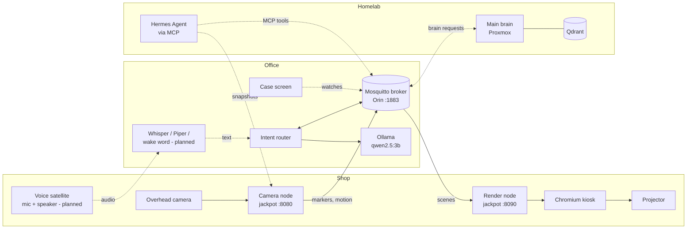

# Lab Assistant: How It Works

A JARVIS-style assistant for an electronics workbench. A projector draws on the
bench itself (hole grids, labels, pinouts), cameras watch what's on it, and you
control it by voice or from the homelab AI. This document explains the parts,
how they talk to each other, and why it's built this way.

Status as of October 2026: projection, cameras, the message broker, the Orin's
local model and the intent router work. Calibration is waiting on the laser-cut
markers; voice and the homelab connection are next.

---

## 1. The machines

| Machine | Where | Job |
|---|---|---|
| **Raspberry Pi 4 "jackpot"** | Shop, over the bench | Camera node and render node: runs the overhead camera and drives the bench projector |
| **Mooka BL-69 projector** | Mounted over the bench | Draws on the bench, 1920 × 1080 over HDMI from jackpot |
| **OV5647 camera** (Pi ribbon camera) | Next to the projector | Overhead view of the bench: markers, motion, snapshots |
| **TOMLOV microscope** | Bench | Close-up camera over USB (set up, off by default) |
| **Jetson Orin Nano** (Yahboom CUBE case) | Office | Sub brain: message broker, local model, intent router, voice processing (planned) |
| **Proxmox server** (RTX 3060 Ti) | Homelab | Main brain: larger language model, Qdrant knowledge base, Node-RED |
| **Mac Mini** | Homelab | Runs Hermes Agent, which reaches the lab through an MCP gateway |
| **Windows PC** (RTX 3090) | Homelab | Vision tier, woken by Wake-on-LAN only when needed |
| **Jetson Nano** (original) | Spare | Reserved for bench vision or a robot project |

The Orin stays out of the shop on purpose (dust), so anything that has to be
physically at the bench (camera, projector, mic) runs on a Pi in the shop, and
the thinking happens elsewhere.

---

## 2. The big picture



Solid lines work today; dotted lines are planned or waiting on hardware.

**One rule ties it together: everything talks through the MQTT broker on the
Orin.** A device that wants something drawn publishes a message; the render
node is subscribed and draws it. Nothing needs to know where anything else
lives, and adding a new device means subscribing it to a topic. The only
exception is camera images, which are too big for messages and are fetched
straight from the camera node over HTTP.

---

## 3. Following one command

What happens when you say *"Jarvis, show me a breadboard grid"* (once voice is
set up):

1. **Satellite** (shop Pi with a mic) hears the wake word and streams your
   voice to the Orin.
2. **Whisper** on the Orin turns the audio into text.
3. The text goes to the **router** on `lab/router/command`.
4. The router's **rules** recognise "show … grid" instantly, with no model
   needed, and decide `show_grid 30 × 10`.
5. The router publishes a **scene** to `lab/display/bench`: one grid item,
   positioned in millimetres on the bench.
6. The **render node** receives it and pushes it to the projector page.
7. The page draws the grid in millimetres and **warps** it with the
   calibration so every hole lands at a real 2.54 mm pitch on the bench.
8. The router publishes a short reply ("30 by 10 grid.") on
   `lab/router/reply`, which **Piper** will speak through the satellite.

Steps 3 to 7 work today: you can test them by publishing the sentence to
`lab/router/command` yourself.

A harder request, *"why won't my ESP32 boot?"*, takes a different path at
step 4: no rule matches, so the **local model** reads it and decides it needs
real thought (`ask_brain`). The router forwards it on `lab/brain/request`; the
**main brain** answers on `lab/brain/reply`, optionally with something to draw,
and the router passes both on.

---

## 4. The parts

### Camera node (`camera_node/`, on jackpot, port 8080)

A small web service around the cameras.

- `GET /snapshot/<camera>.jpg` gives a full-resolution photo (optionally
  resized with `?max_width=`).
- `GET /markers/<camera>` lists the ArUco markers it can see.
- `GET /motion/<camera>` says whether something is moving on the bench.
- A background loop watches a low-resolution stream five times a second for
  markers and motion, and publishes changes on `lab/camera/<name>/markers` and
  `lab/camera/<name>/motion`.

The Pi camera has two streams at once (picamera2): full resolution for
snapshots, a small one for cheap continuous tracking. The microscope is a USB
camera and is configured but switched off until needed.

### Render node (`render_node/`, on jackpot, port 8090)

Draws on the projector. A Flask server holds "what should be on the bench"; a
Chromium window in kiosk mode shows the server's page fullscreen on the
projector, and the server pushes every change to it instantly (Server-Sent
Events).

Two modes:

- **Scene**: shapes in **bench millimetres** (rectangles, circles, lines,
  text, images, hole grids, crosses). This is what everything normally uses.
- **Pattern**: a raw full-screen image in projector pixels. Calibration uses
  this for its white frame and marker grid.

Scenes arrive by HTTP (`POST /scene`) or MQTT (`lab/display/bench`).

**How millimetres become projector pixels.** The page draws the scene as SVG at
a few pixels per millimetre, then applies a single CSS `matrix3d` transform
built from the calibration homography. The browser's GPU does the warp, so a
rectangle drawn square in millimetres lands square on the real bench even
though the projector is mounted at an angle. The page picks the pixels-per-mm
(1 to 4) from the calibration so small text stays sharp after warping.

### Calibration (`calibration/`)

Calibration answers one question: *which projector pixel lights up bench
position (x mm, y mm)?* It is solved as two simpler mappings and multiplied
together:

```
bench mm  --(printed markers)-->  camera pixels  --(projected markers)-->  projector pixels
H_bench_to_proj = H_cam_to_proj  ×  H_bench_to_cam
```

1. Four **laser-engraved ArUco markers** (IDs 0–3) are taped to the bench and
   their centres measured in millimetres. The projector shows plain white, the
   camera finds the markers, and that gives **bench → camera**.
2. The projector shows a **grid of 24 ArUco markers** (IDs 20+) at known pixel
   positions. The camera finds them, which gives **camera → projector**.
3. Multiply, save `calibration/bench.json`, send it to the render node, and
   project yellow crosses that should land on the printed markers as a check.

Marker IDs are split into ranges so they can never be confused: 0–9 printed on
the bench, 10–19 for breadboards and boards later, 20–99 projected.

If the tripod gets bumped but the camera and projector moved together, only
step 1 has to be redone (`--bench-only`, a few seconds).

### Message broker (Mosquitto, on the Orin, port 1883)

The post office. Every message has a **topic** (like a mailbox name) and
anyone subscribed to that topic gets a copy. Logins are required; an access
list (`config/mosquitto-acl.example`) gives the homelab its own login that can
only draw, switch devices and talk to the router.

### Intent router (`orin/router.py`, on the Orin)

Turns one sentence into one action. It works in three tiers, cheapest first:

1. **Rules.** Regular expressions catch the everyday commands ("lights on",
   "clear the bench", "show a 20 by 5 grid") in under a millisecond.
2. **Local model.** Everything else goes to `qwen2.5:3b` in Ollama on the
   Orin's GPU. It is forced to answer in a fixed JSON shape (Ollama's `format`
   option with a JSON schema), so the answer can always be checked. A model
   that invents a device that doesn't exist gets overruled.
3. **Main brain.** Questions, explanations and anything uncertain are passed
   up as `ask_brain`.

Actions it can take today: `show_text`, `show_grid`, `clear_bench`,
`set_device` (lights, exhaust, fan) and `ask_brain`.

**Everything is logged.** Each decision is written to `logs/router.jsonl` with
the sentence, which tier handled it, the model's raw answer and how long it
took. You can mark any decision right or wrong (from the command line or on
`lab/router/feedback`). If the small model keeps misreading your phrasing,
that log becomes the training data for a fine-tune.

`python3 orin/router.py try "turn on the exhaust fan"` shows what a sentence
would do without sending anything.

### Case screen (`orin/oled_stats.py`)

The small OLED on the Orin's case rotates three pages: system (CPU, RAM, disk,
IP), Jetson (GPU load, power mode, temperatures, fan) and lab services (MQTT,
Ollama, voice, time since the last message). It dims overnight, shifts a pixel
now and then against burn-in, and flashes a warning if the Orin runs hot.

### Homelab tools (`homelab/`)

How Hermes Agent and the main brain reach the lab. `lab_tools.py` wraps the lab
as plain Python functions; `mcp_server.py` serves them as MCP tools:

| Tool | Does |
|---|---|
| `show_on_bench` | Draw any scene (validated: known item types, at most 500 items) |
| `show_text`, `clear_bench` | Shortcuts for the common cases |
| `set_device` | Switch a device; names are checked so a tool call can't inject MQTT wildcards |
| `bench_snapshot` | Photo from the overhead camera, so the AI can *see* the bench |
| `bench_markers` | Which markers the camera sees right now |
| `ask_lab` | Send a sentence to the router as if you'd said it, and wait for the reply |

Settings come from `LAB_*` environment variables, so no address or password
lives in the code.

---

## 5. Topic map

| Topic | From → to | Payload |
|---|---|---|
| `lab/display/<surface>` | router, homelab → render node | `{"items": [...], "append": false}` (bench mm) |
| `lab/display/<surface>/pattern` | calibration → render node | `{"kind": "white"}` etc. |
| `lab/camera/<name>/markers` | camera node → anyone | visible marker IDs and corners (retained) |
| `lab/camera/<name>/motion` | camera node → anyone | `{"active": true, "t": ...}` (retained) |
| `lab/router/command` | voice, homelab, you → router | `{"text": "...", "source": "voice", "id": "optional"}` or plain text |
| `lab/router/reply` | router → voice, homelab | `{"id", "text", "intent"}` |
| `lab/router/feedback` | you → router log | `{"id", "correct", "expected"}` |
| `lab/brain/request` | router → main brain | `{"id", "text", "source"}` |
| `lab/brain/reply` | main brain → router | `{"id", "text", "scene"?, "surface"?}` |
| `lab/device/<name>/set` | router, homelab → Home Assistant / ESPHome | `{"state": "on" \| "off"}` |

---

## 6. Coordinates

Everything that draws uses **bench millimetres**: origin at printed marker 0,
x to the right, y toward the front of the bench. The bench is 48 × 24 in
(about 1220 × 610 mm). Nothing outside calibration ever deals with projector
pixels, so recalibrating never changes anyone's drawings.

---

## 7. Why it's built this way

- **A message broker in the middle.** Devices don't need each other's
  addresses, any number of things can listen to one event, and the homelab can
  join without touching shop code.
- **HTTP for images, MQTT for everything else.** Photos are megabytes; events
  are bytes.
- **A web page for projection.** The browser already does fast, sharp,
  GPU-accelerated drawing and perspective warps. One CSS transform replaces a
  custom graphics pipeline.
- **Two homographies instead of one.** The camera is the measuring tool that
  links the bench to the projector, so calibration is automatic: no clicking
  on corners by hand.
- **Rules before the model, small model before the big one.** Most commands
  are routine; they should be instant and never wake the homelab. The model
  only sees what rules can't handle, and the main brain only sees what the
  small model can't.
- **Knowledge in Qdrant, not in model weights.** Datasheets and notes change;
  a database updates instantly and can cite its source. Fine-tuning is kept
  for phrasing (from the router log) and for recognising your specific parts
  on camera.
- **Separate logins per role.** The homelab can draw and switch devices but
  can't impersonate a camera or read everything.

---

## 8. Repository

```
camera_node/   camera service (snapshots, markers, motion)
render_node/   projector server + kiosk page
calibration/   marker generation, lens and projector calibration
labassist/     shared code: ArUco detection, homography maths, MQTT, config
orin/          router.py (intent router), oled_stats.py (case screen)
homelab/       lab_tools.py + mcp_server.py for Hermes
config/        *.example.yaml (copy and edit; real configs are git-ignored)
systemd/       services: camera-node, render-node, lab-router, oled-stats
tests/         offline tests with synthetic images and fake services
docs/          this document
```
