# Projector Calibration: How It Works

This guide explains what the bench calibration does, step by step, using
photos from the first real calibration of the shop bench (October 2026). It
covers making the markers, placing and measuring them, what the camera
actually detects at each step, how the result is used to draw, and what went
wrong along the way.

The short version: **calibration finds a single 3×3 matrix that converts a
position on the bench in millimetres into a pixel on the projector.** Once
that exists, anything (the router, Hermes, a script) can say "draw a hole grid
at 200 mm, 50 mm" and it lands there, even though the projector is mounted at
an angle.

---

## 1. The problem

The projector hangs above the bench at an angle. A square drawn on its screen
lands on the bench as a skewed four-sided shape, bigger at the far side, and
nowhere near any particular spot. To put a dot on a specific breadboard hole
you need to know which projector pixel lights up that exact point.

Because the bench is **flat**, the relationship between "points on the bench"
and "pixels on the projector" is a *homography*: a 3×3 matrix `H` that maps
any point on one flat plane to the matching point on another flat plane:

```
[u']       [x]          projector pixel  u = u'/w,  v = v'/w
[v'] = H × [y]          bench point (x, y) in mm
[w ]       [1]
```

Eight numbers (the ninth is just scale) describe the whole warp: perspective,
rotation, scale, shift. Four known point pairs are the minimum to solve it;
calibration uses many more and averages out the error.

The catch is that the projector cannot see. So the **camera** acts as the
measuring tool in between:

```
bench mm  --(printed markers)-->  camera pixels  --(projected markers)-->  projector pixels

H_bench_to_proj  =  H_cam_to_proj  ×  H_bench_to_cam
```

Each half is measured separately with ArUco markers, then the two are
multiplied. (Multiplying two homographies gives another homography, so the
final result is still one 3×3 matrix.)

---

## 2. The markers

ArUco markers are square black-and-white codes that OpenCV can find in an
image and identify by number. Each detection gives the marker's **ID** and its
**four corner positions** to sub-pixel accuracy. We use the `DICT_4X4_100`
family (a 4×4 grid of cells inside a black border), with IDs split into
ranges so a printed marker can never be mistaken for a projected one:

| IDs | What | Where |
|---|---|---|
| 0–3 (up to 9) | Printed bench markers | Taped at the corners of the work area |
| 10–19 | Reserved for boards and trays | Later |
| 20–99 | Projected during calibration | Drawn by the projector |

### What a good marker needs

- **Strong contrast.** The detector converts the photo to black and white
  using local thresholds. A mid-brown burn on light wood is borderline.
- **A white border (quiet zone) of at least 10 mm** around the black square.
  The detector finds markers by their outer black edge; anything dark
  touching it (tape, a cable, a dark bench) can merge into it.
- **Correct polarity and no mirroring.** Black border outside, pattern
  inside. A mirrored marker decodes as a different ID or not at all.
- **Flat.** All four must lie on the same plane as the bench surface.

The size isn't critical. Ours are 60 mm. The calibration only uses each
marker's **centre**, so it never needs to know the marker size.

### Making them: what we learned

The markers come from `calibration/generate_markers.py`. It writes a
letter-size PNG for printing at 100% and an SVG with exact millimetre sizes
for a laser (black = engrave, red = cut).

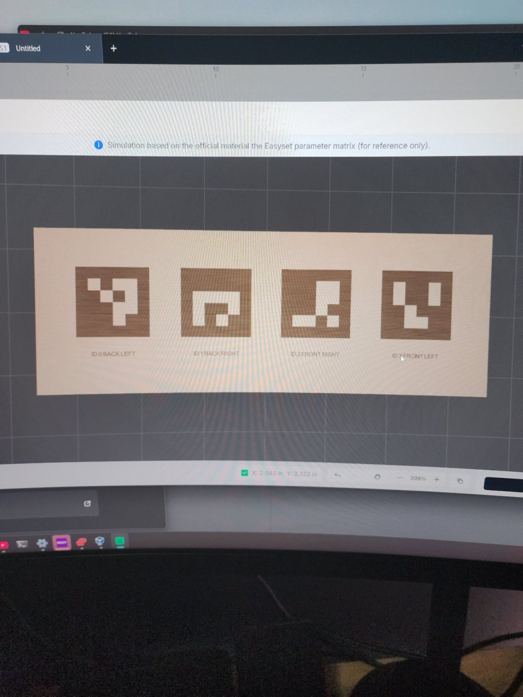
*The laser software preview, checked before engraving: dark border outside, pattern inside, ID 0's light corner cell at top-left. This shows the polarity is correct and the image isn't mirrored.*

The first batch was engraved with several fast, low-power passes (280 mm/s
at 40%) to avoid a smoke halo. It looked fine to the eye, but the detector
disagreed:

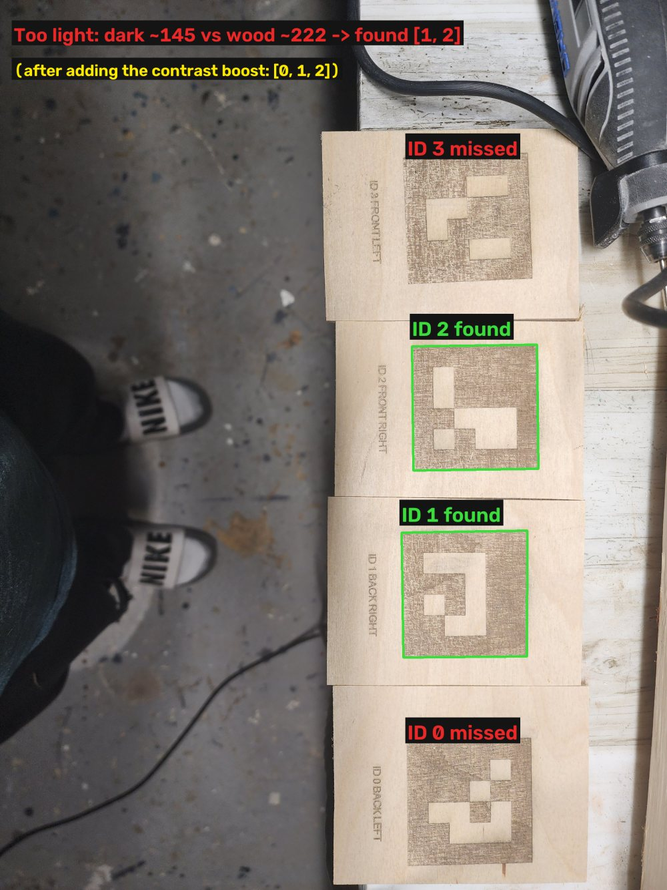
*First engraving. Measured brightness: burned areas about 145 out of 255, bare wood about 222. That's not enough contrast, so the original detector found only IDs 1 and 2. Adding a contrast-boost pass to the detector rescued ID 0, but ID 3 still failed.*

Darkening the burned areas with a black permanent marker fixed it
completely. The engraved edges act as a stencil, so the corners stay crisp:

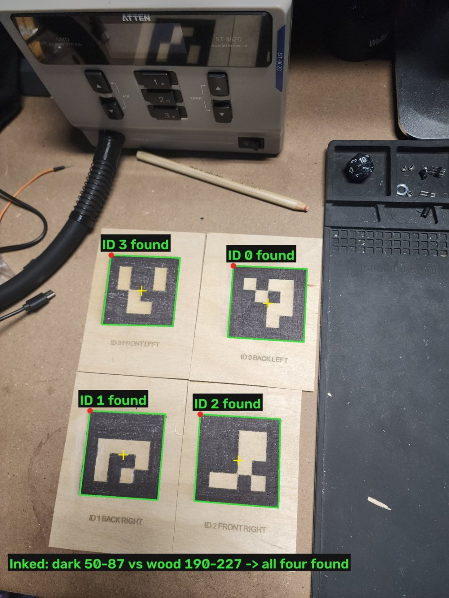
*After inking: dark areas 50–87, wood 190–227. All four are found, even when the photo is shrunk until each marker is only about 30 pixels across. Plain OpenCV with no extra help finds them too. Green outline: the detected marker. Red dot: its corner 0 (which tells the detector its rotation). Yellow cross: the centre that calibration uses.*

**Rule of thumb:** check any new marker before relying on it. Photograph it
straight on and run:

```bash
python3 tools/diagnose_markers.py --image photo.jpg
```

It tries the detector with several settings and lists which IDs each one
finds.

---

## 3. Placing and measuring the markers

### Where they go

Tape the four markers near the corners of the area you want to project on:

- **ID 0 at the back left.** This becomes the origin (0, 0).
- **ID 1 back right, ID 2 front right, ID 3 front left.**
- Inside the camera's view, and ideally fully inside the projected image.
  Never put a marker half in and half out of the light: a hard light edge
  across a marker can stop it being detected when the projector goes white.
- Flat on the bench. A plate hanging over the bench edge tilts and breaks
  the "one flat plane" assumption.
- Tape at least 1 cm away from the black squares (see section 8).

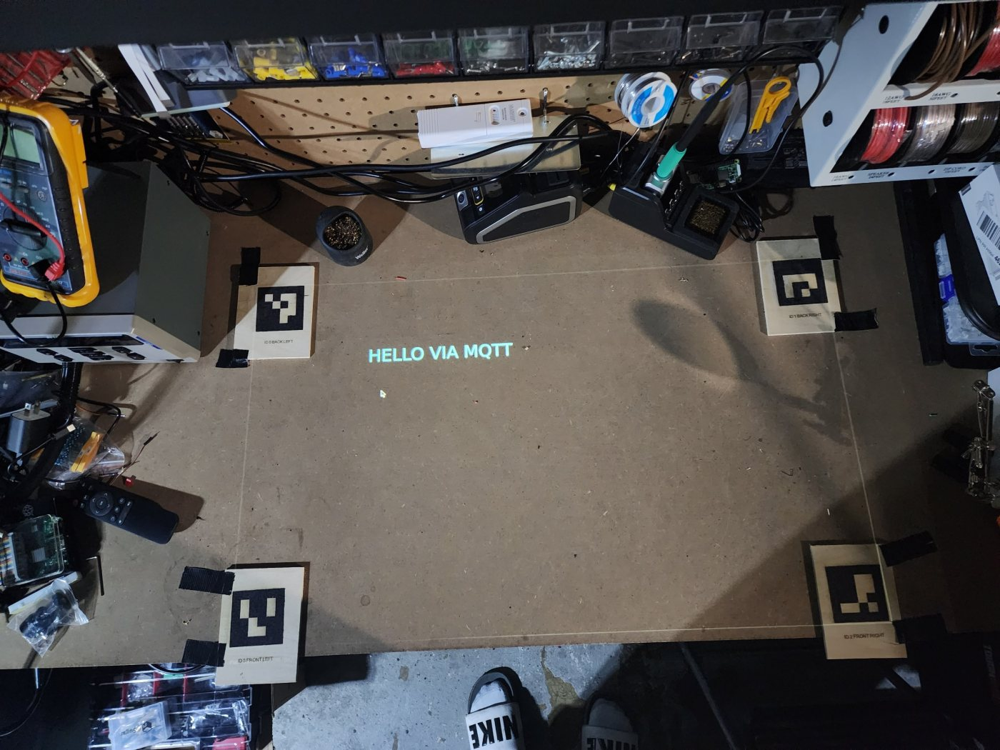
*The final layout. The tape is on the plates' outer corners, and all four plates lie flat on the work surface.*

### Coordinate system

All drawing uses **bench millimetres**:

- Origin: the centre of marker 0.
- x runs to the right (toward marker 1).
- y runs toward you (toward marker 3).

### Measuring

Measure **centre to centre**. You don't need to find the centres: measure from
the **same edge** of each black square (left edge to left edge, back edge to
back edge). Because the squares are identical, that distance equals the
centre-to-centre distance.

> **The mistake we made:** measuring from the *outside* edge of one square to
> the *outside* edge of the other. That includes one extra square width.
> 29 in × 17¼ in measured outside-to-outside, minus one 60 mm square, gives
> the real **676 × 378 mm**. A rough estimate from a photo (650–680 × 350–380)
> is what caught it.

The positions go in `config/bench.yaml` (per machine, not in git):

```yaml
surface: bench
camera_url: http://<jackpot-ip>:8080
camera: bench-overhead
render_url: http://<jackpot-ip>:8090
projector_size: [1920, 1080]
intrinsics: calibration/intrinsics-bench-overhead.json   # optional; skipped if missing
output: calibration/bench.json
margin_mm: 60                       # drawable area extends this far past the markers

bench_markers:                      # marker centres, mm
  0: [0, 0]       # back left (origin)
  1: [676, 0]     # back right
  2: [676, 378]   # front right
  3: [0, 378]     # front left
```

If the markers don't form a perfect rectangle, put each one's real position.
Calibration uses the actual numbers, so 2–3 mm of misalignment doesn't
matter as long as it's measured.

---

## 4. Before you run it

The calibration script checks these first and stops with a plain message if
one is missing:

1. **The camera service** is answering and has the camera named in the
   config.
2. **The render server** is answering.
3. **The projector page is open.** Chromium kiosk shows the render page, so
   at least one "viewer" is connected.

And check by eye:

- **The projector is on the Pi's HDMI input** and shows black (the empty
  render page), not its own menu.
- **The room is fairly dark.** The projector has to be the main light.
- **Nothing covers a marker.** That includes cables and hands.

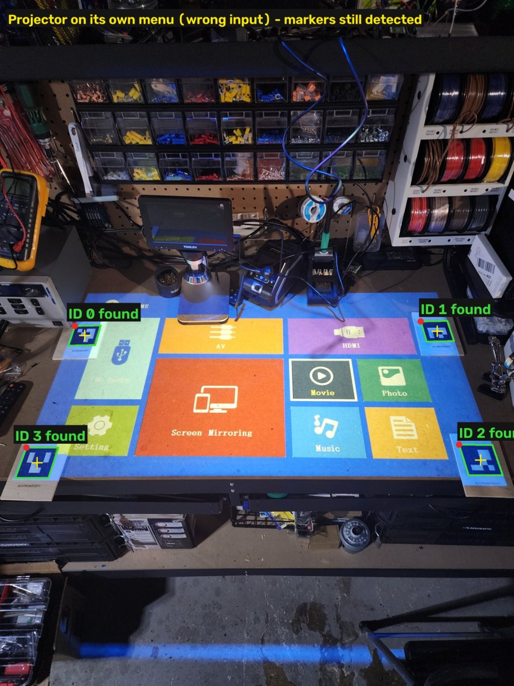
*Not ready: the projector is showing its own home menu instead of the Pi. All four markers are still detected under the coloured light, but calibration needs the Pi's page on screen so it can project its patterns.*

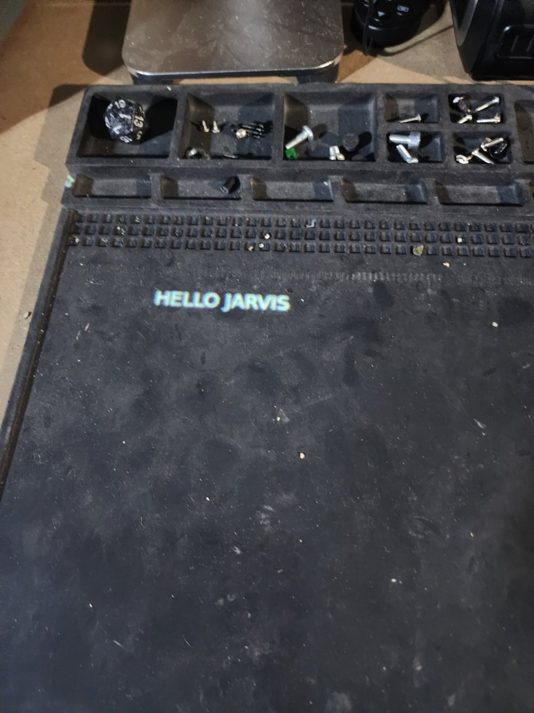
*Ready: the render page is on the projector. This was the first test text, sent before calibration, so it isn't positioned in millimetres yet.*

It also helps to focus the projector first:
`python3 tools/send_scene.py --render-url http://<jackpot-ip>:8090 focus`
projects a focus chart. Turn the focus ring until the star centres and the
1-pixel lines are crisp, then send `clear`.

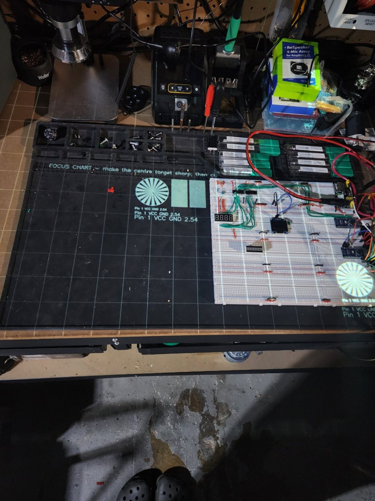
*The focus chart: a 1920 × 1080 test image with a sharpness target in the centre and each corner.*

---

## 5. Running calibration

```bash
cd ~/lab-assistant
python3 calibration/projector_calibrate.py --config config/bench.yaml
```

Add `--save-images` to keep the photos it takes (`calibration/capture-bench.jpg`,
`calibration/capture-pattern.jpg`) for troubleshooting.

### Step 1: find the printed markers (bench → camera)

1. The projector goes **plain white** so the printed markers are evenly lit,
   even in a dark room.
2. After 2 seconds (`--settle`), the camera takes a full-resolution snapshot.
3. The detector finds markers 0–3 and takes each one's **centre** in camera
   pixels.
4. Four pairs (bench mm ↔ camera px) give **`H_bench_to_cam`**.

This is what the camera sees, and what the result means:

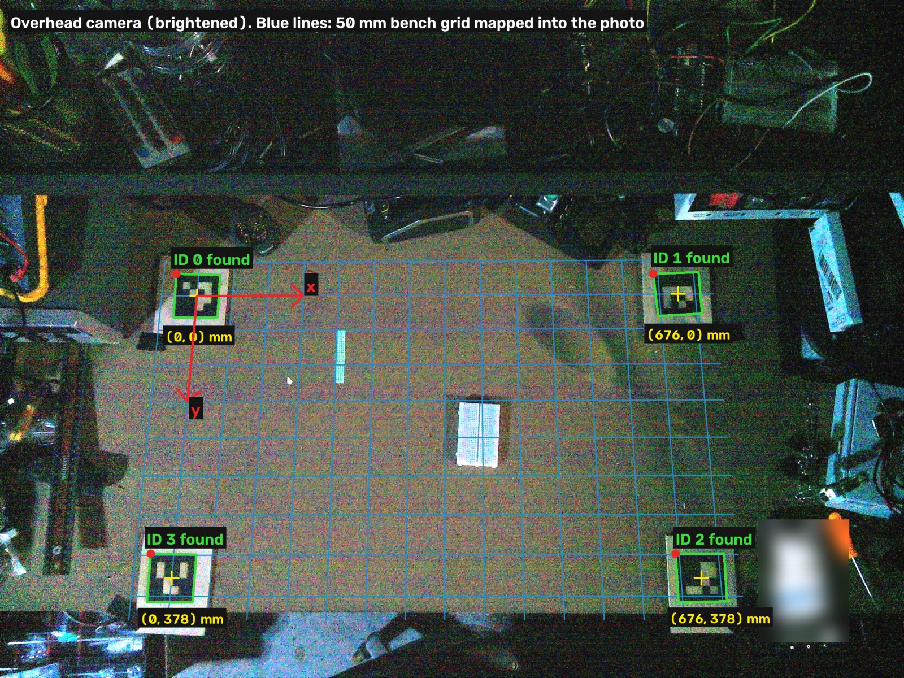
*The overhead camera's own snapshot, brightened for viewing. Each green outline is a detected marker, with its ID; the yellow labels are the millimetre positions from `bench.yaml`. The red arrows are the bench x and y axes, starting at marker 0's centre. The blue lines are a 50 mm grid in bench millimetres, drawn into the photo using the mapping. They line up with the markers and follow the camera's perspective, which shows the mapping is right. (The phone screen at the bottom right is blurred.)*

How the detector finds them:

- It looks at the full-resolution image, then the same image at ½ and ¼
  size. On the Pi's OpenCV version, full-size frames sometimes miss markers
  that half-size frames catch.
- It also looks at a **contrast-boosted** copy (CLAHE), which rescues
  low-contrast markers like the first engraved batch.
- Corners found on a smaller copy are refined against the full-resolution
  image, so accuracy isn't lost.
- With a lens calibration (`lens_calibrate.py` and the printed checkerboard),
  lens distortion is removed first. That's optional; without it the marker
  sizes read about ±5% off near the image edges.

### Step 2: find the projected markers (camera → projector)

1. The projector shows a grid of **24 ArUco markers** (IDs 20–43), 6 across
   and 4 down. Their exact pixel corners are known, because the script drew
   them.
2. The camera photographs the bench. Each projected marker it finds gives
   **4 corner pairs** (camera px ↔ projector px), up to 96 pairs in total.
3. A homography is fitted to all of them with **RANSAC**, which ignores
   outliers (such as a marker partly falling on an object) and reports the
   mean and maximum error in projector pixels.

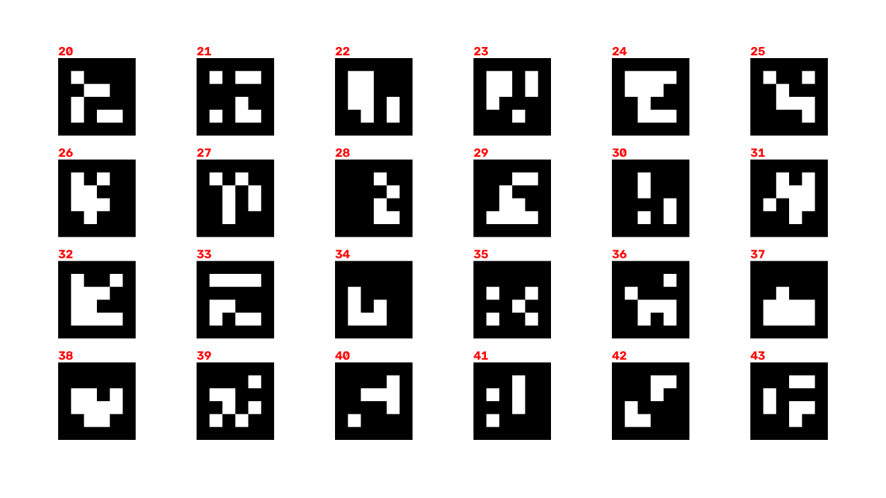
*What the projector shows in step 2 (reduced; red numbers added here for reference). On the bench it lands skewed. The camera sees the skew, which is exactly what this step measures.*

Steps 1 and 2 don't depend on each other. Step 2 only depends on the camera
and projector staying put relative to each other.

### Step 3: combine, save, check

```
H_bench_to_proj = H_cam_to_proj × H_bench_to_cam
```

The script then:

- **saves** everything to `calibration/bench.json`: all three matrices, the
  marker positions, the drawable area, the image sizes and the error report;
- **sends** it to the render node, which uses it immediately and reloads it
  at boot;
- **projects a check pattern**: a 50 mm grid over the drawable area, the
  area's outline, and a **yellow cross on each marker's measured centre**.

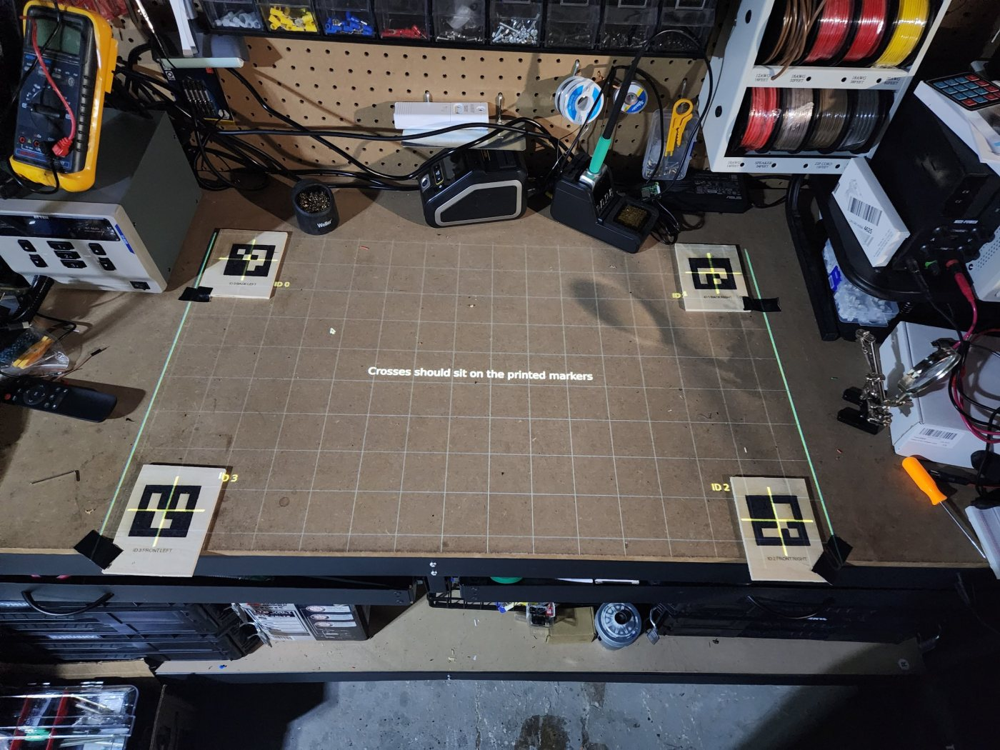
*The check pattern after the real calibration. Each yellow cross lands on the centre of its marker's black square, the 50 mm grid is straight and evenly spaced from back to front even though the projector is at an angle, and the outline around everything marks the drawable area (the markers plus a 60 mm margin).*

**How to read the check:**

| You see | Meaning |
|---|---|
| Crosses on the square centres | Good. Done. |
| All crosses shifted the same way | One marker position in `bench.yaml` is off, or the camera moved between steps |
| Crosses right at one corner, wrong at the opposite one | A measurement error, or a marker that isn't flat |
| Grid lines curved | Lens distortion. Run the lens calibration |
| Script stops: "bench markers missing" | A marker is covered, too dim, or outside the camera view. Re-run with `--save-images` and look at `capture-bench.jpg` |
| Script stops: "only N projected markers seen" | Room too bright, projector out of focus, or the camera can't see the whole projection |

---

## 6. How drawing uses the calibration

The render page (Chromium in kiosk mode on the projector) draws every scene
as SVG in **millimetres**, then applies one CSS transform:

- `H_bench_to_proj` becomes a CSS `matrix3d(...)` on the drawing layer.
  The browser's GPU does the perspective warp, so a rectangle drawn square in
  millimetres lands square on the real bench.
- To keep small text and fine lines sharp after warping, the page draws at
  **k pixels per millimetre**, where k = 1–4 is picked from the calibration
  (the most projector pixels any 1 mm covers, × 1.5), then scales the
  matrix down to match.

Everything else in the system only ever deals in millimetres. Recalibrating
never changes anyone's drawings.

### Real-world check: the breadboard

The first test after calibration was projecting a 2.54 mm hole grid onto a
real breadboard:

```bash
python3 tools/send_scene.py --render-url http://<jackpot-ip>:8090 holes <x_mm> <y_mm> <cols> <rows>
```

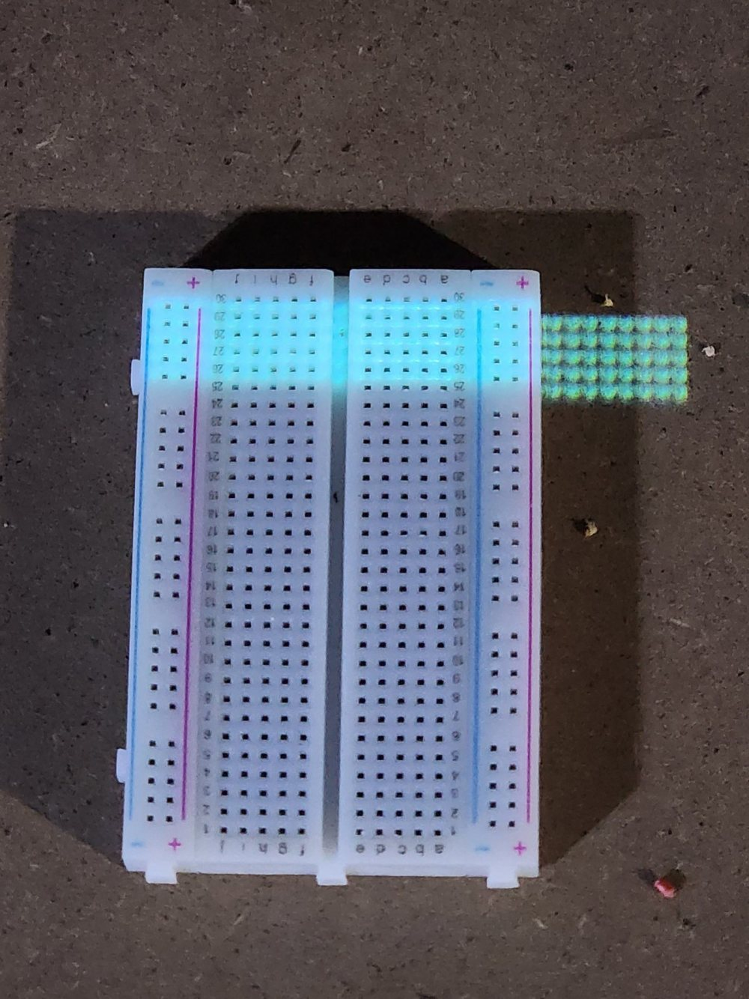
*First try: a 30 × 5 grid (long side left to right) onto a breadboard whose long side ran front to back. The orientation was wrong, but the dot spacing on the bare bench matches the hole spacing, which shows the scale is right.*

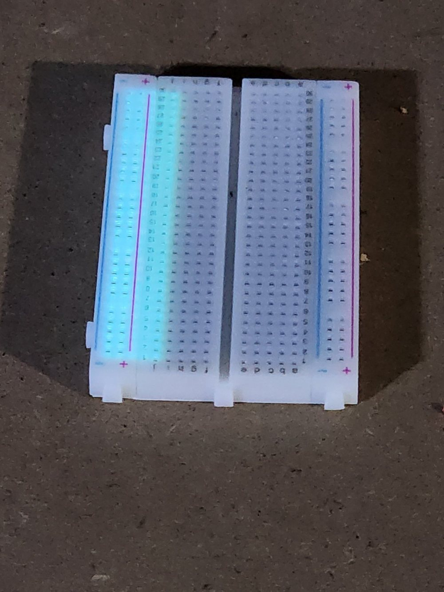
*Second try: 5 × 30. The projected column runs exactly from row 30 to row 1, about 74 mm, so the scale is correct along the board. It's shifted one block sideways, which was the hand-measured x being about 11 mm off, not a calibration problem. The white plastic scatters light, so dots glow together on the board; on bare MDF they stay separate.*

---

## 7. Finding things without markers (board finder)

Calibration also works in reverse: `inverse(H_bench_to_cam)` turns any camera
pixel into bench millimetres. That lets the camera find objects with no
marker on them. `tools/find_board.py` does this for breadboards:

1. Flash the projector white, snapshot, put back what was showing.
2. Mask to the bench area, cutting out the four marker plates (they're
   bright and about breadboard-sized).
3. Score every pixel by **how much whiter it is than the bench around it**:
   brightness minus a heavily blurred copy of the bench. Only bench pixels
   feed the blur, so the dark surroundings don't distort it. In good light,
   colourfulness is subtracted too, because white plastic is colourless and
   MDF is brown.
4. Threshold, clean up, fit the smallest rotated rectangle around each blob,
   map its corners to millimetres, and keep shapes that are solid,
   rectangular and board-sized.
5. Print size, centre and angle; project the outline back as a check.

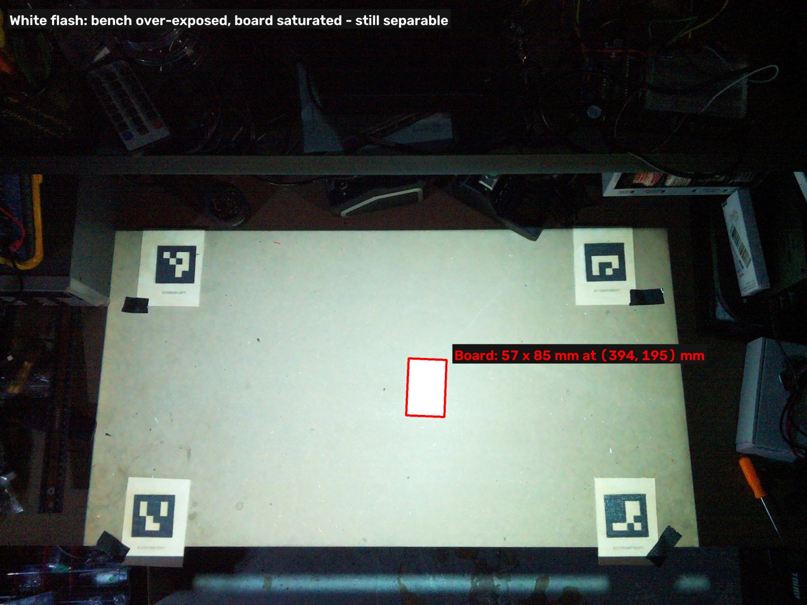
*The real flash photo from the overhead camera. The bench is over-exposed (nearly white) and the breadboard is completely saturated, but it's still whiter than the bench next to it. Found: about 57 × 85 mm at (393, 195) mm, against a real half-size breadboard of 55 × 83 mm. The extra 1–2 mm is the board's sides, which the camera sees at a slight angle.*

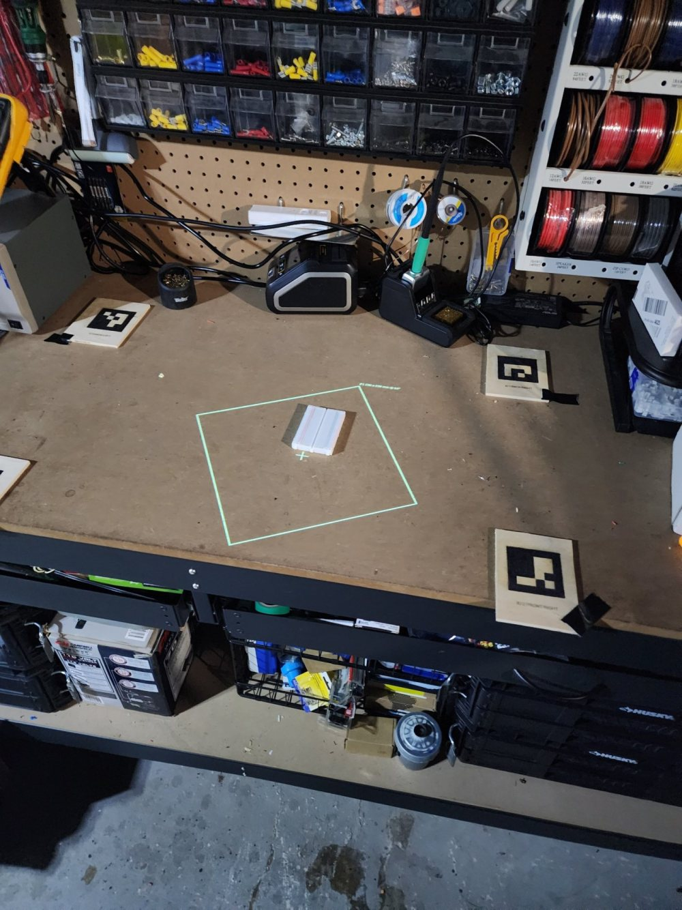
*Before the fix: the first version compared the board with the whole bench. The projector is brighter in the middle, so a large patch of bench passed the "bright" test, and the box came out about 230 mm across. Comparing with the bench immediately around the board fixed it.*

---

## 8. Troubleshooting: things that actually happened

| Problem | Symptom | Fix |
|---|---|---|
| Burn too light | Some IDs not found; brightness difference under about 80 | Darker burn, or black marker over the burned areas |
| Cable across a marker | That ID missing | Keep markers clear during calibration |
| Black tape touching the black square | Marker drops out at smaller image sizes | Tape ≥ 1 cm away, or clear tape, or tape underneath |
| Plate overhanging the bench edge | Calibration skewed at that corner | Whole plate flat on the work surface |
| Marker across the edge of the projected light | Drops out when the projector goes white | Fully inside or fully outside the projection |
| Projector on its own menu | Script stops: no viewer, or patterns don't appear | Projector input to HDMI; kiosk running |
| Outside-edge measurements | Everything stretched by one marker width | Measure same edge to same edge |
| Phone photo vs camera | A marker found on the phone but not by the overhead camera (or the reverse) | Always test with the camera's own snapshot: `curl -o snap.jpg http://<jackpot-ip>:8080/snapshot/bench-overhead.jpg` |

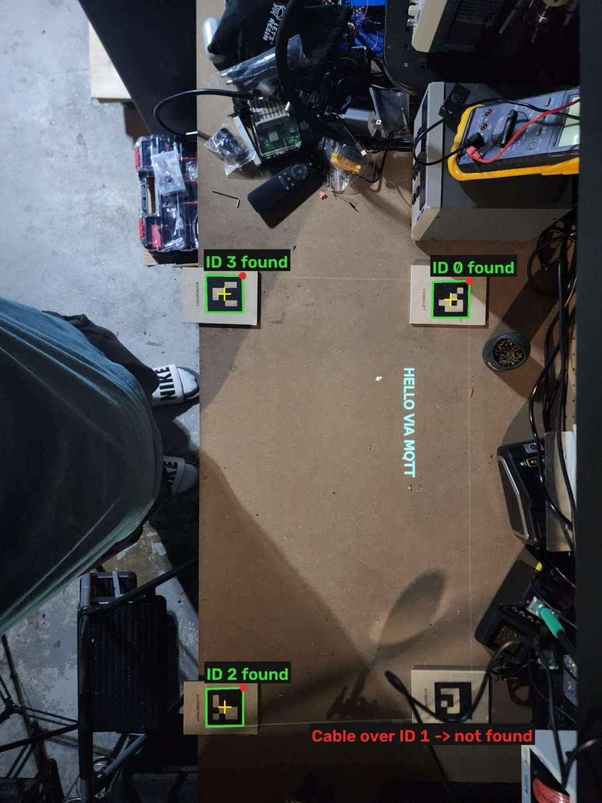
*A phone photo run through the detector: IDs 0, 2 and 3 found; ID 1 missed because a cable lies across its black square.*

---

## 9. Keeping it calibrated

- **Nothing on the bench affects calibration.** Tools, the mat and
  breadboards can come and go. Only the camera, projector and bench surface
  matter.
- **If the camera or projector is bumped, re-run with `--bench-only`.** It
  repeats step 1 only (re-finds the printed markers) and reuses the saved
  camera-to-projector mapping, which takes a few seconds. That works if the
  camera and projector moved together. If only one of them moved, run the
  full calibration.
- **The markers aren't needed day to day.** The calibration is saved. But to
  recalibrate, they must go back in **the same positions** (mark them, or pin
  them), or be re-measured into `bench.yaml`. Moving marker 0 moves the
  origin, which shifts all bench coordinates.
- **Objects above the bench surface** (a breadboard is about 9 mm tall, a mat
  a few mm) project slightly off, about 1 mm here. The calibration describes
  the bench plane only.

---

## 10. Reference

| Command | Does |
|---|---|
| `python3 calibration/generate_markers.py --out prints/` | Marker sheet (PNG, print at 100%) and laser SVG; checkerboard for lens calibration |
| `python3 tools/diagnose_markers.py --image photo.jpg` | Which markers the detector finds in a photo, under several settings |
| `python3 tools/send_scene.py --render-url URL focus` | Focus chart; `clear` to remove |
| `python3 calibration/projector_calibrate.py --config config/bench.yaml` | Full calibration |
| `... --bench-only` | Re-find printed markers only (after a bump) |
| `... --save-images` | Keep the calibration photos |
| `python3 tools/send_scene.py --render-url URL holes X Y COLS ROWS` | 2.54 mm hole grid at bench position X, Y |
| `python3 tools/find_board.py --config config/bench.yaml` | Find a breadboard with no marker; project its outline |

| File | Contains |
|---|---|
| `config/bench.yaml` | URLs, marker positions, margin (local, git-ignored) |
| `calibration/bench.json` | The result: `H_bench_to_cam`, `H_cam_to_proj`, `H_bench_to_proj`, area, error report (local, git-ignored) |
| `labassist/aruco.py` | Marker detection (multi-scale, contrast boost, corner refinement) |
| `labassist/calib.py` | Pattern generation and the two solves |
| `render_node/static/render.js` | The CSS `matrix3d` warp and sharpness scale |
| `labassist/board.py` | Board finder |
